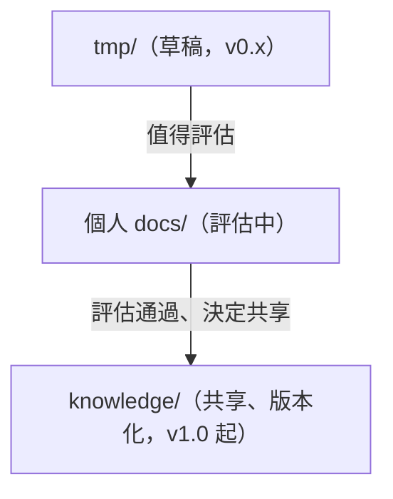

# AI 協作的工作區結構：多專案、worktree 與檔案即看板

> 當一個人（或一個小組）同時帶多個專案，並讓多個 AI 程式碼代理 session 平行工作時，資料夾怎麼擺、分支怎麼隔離、任務怎麼追蹤、知識怎麼累積？本篇記錄我用的三層工作區、用 Markdown 檔當看板的做法，以及知識從草稿升級到共享的管線。我主要用 Claude Code，但這些結構與代理工具無關。2026 年寫成，專案名稱一律用 projectA、projectB 代替。

## 問題：多專案加多 session 會互相踩

我遇到的狀況是：

- 同時有幾個後端專案在做，每個專案常常有兩三條分支在平行開發。
- 每條分支都可能同時開著一個 AI session。
- AI 用到的東西很雜：專案的說明文件、慣例、記憶、任務草稿、測試報告。

沒有結構時會發生這些事：

1. 同一個專案的 AI 說明文件，在每個 checkout 各有一份，改了一份忘了另一份。
2. 兩個 session 在同一個工作目錄裡切分支，互相覆蓋。
3. 任務進度散落在對話、便利貼、聊天軟體裡，換個 session 就找不到。
4. 好不容易整理出來的經驗，留在某次對話裡，下次又重來。

我的解法有三塊，各自獨立也能單獨用：

| 塊 | 解決什麼 |
|---|---|
| 三層工作區 | 多專案、多分支的資料夾結構與 AI 資源擺放 |
| 檔案即看板 | 任務追蹤，用資料夾與 Markdown 檔表達狀態 |
| 知識升級管線 | 草稿、評估、共享，逐級升級 |

## 一、三層工作區

### 結構

```text
projects/
├── projectA-workspace/        # 專案家目錄層
│   ├── .claude/               # 這個專案唯一一份 AI 資源
│   ├── projectA/              # 主 checkout（預設分支）
│   ├── banner/                # worktree（分支 feature-banner）
│   └── login-fix/             # worktree（分支 hotfix-login-fix）
└── projectB-workspace/
    ├── .claude/
    ├── projectB/
    └── export-csv/
```

三層指的是：

1. **工作區根**：放所有專案的地方。
2. **專案家目錄**（`projectA-workspace/`）：這個專案的一切都在這裡。
3. **checkout 層**：主 checkout 與各個 worktree，彼此平級。

### 為什麼 AI 資源放在家目錄層

最關鍵的設計是：**專案的 AI 資源（說明檔、參考文件、記憶）放在家目錄層的 `.claude/`，不放在任何一個 checkout 裡。**

原理是 Claude Code 這類工具會從目前目錄一路往父層找說明檔與設定。所以：

- 主 checkout 與所有 worktree 的父層是同一個家目錄，自動繼承同一份 `.claude/`。
- 不需要在每個 worktree 複製一份，更不需要同步。
- 改一次，所有分支的 session 都看到新版。

更早之前我是把 AI 資源放在 checkout 裡、再同步到每個 worktree，結果是版本漂移與「忘了同步」。換成家目錄層之後，這一整類問題消失。

只有一類東西仍是 per-checkout：本機設定檔（例如權限設定與工具設定檔）。這類檔案若沒被 git 追蹤，新 worktree 會缺，所以建完 worktree 後要補一次。下面講。

### 用 git worktree 平行開發

worktree 讓同一個 repo 能同時檢出多個分支到不同資料夾，共用同一份 git 歷史。對 AI 協作的好處是：每個 session 有自己獨立的工作目錄，不會互相切分支。

命名規則：

- worktree 目錄名叫 `{branch_slug}`，是分支名去掉 `feature-`、`hotfix-`、`bugfix-` 這類前綴後的 kebab-case。
- 目錄名**不帶專案名前綴**，因為父層已標明專案。

```text
feature-banner             → projectA-workspace/banner
hotfix-login-redirect-loop → projectA-workspace/login-redirect-loop
release-2026-q2            → projectA-workspace/release-2026-q2   # release- 不剝除
```

建立新分支與 worktree：

```bash
git -C projects/projectA-workspace/projectA fetch origin
git -C projects/projectA-workspace/projectA \
  worktree add -b feature-banner ../banner --no-track origin/develop
```

我把建立與移除包成一個固定的 skill，原因只有一個：避免手動命名漂移。

### 一個踩過的坑：`--no-track`

建 worktree 時，如果起點是遠端追蹤分支（`origin/develop`），git 預設會把新分支的 upstream 設成它。我實際遇到的後果有兩個：

- 第一次無參數 `git push` 被 `push.default=simple` 拒絕時，git 的第一個建議是 `git push origin HEAD:develop`。照抄就等於直推開發主線，繞過合併請求流程。
- `git status` 顯示的領先、落後，是跟開發主線比，而不是跟自己的遠端分支比，容易誤讀。

所以我一律帶 `--no-track`，首次推送用 `git push -u origin HEAD`，把 upstream 設到同名遠端分支。

### 建完 worktree 要補的東西

```bash
mkdir -p "${WORKTREE_DIR}/.claude"
for f in settings.json settings.local.json .mcp.json; do
  if [ -f "${PROJECT_DIR}/.claude/${f}" ] && [ ! -e "${WORKTREE_DIR}/.claude/${f}" ]; then
    command cp "${PROJECT_DIR}/.claude/${f}" "${WORKTREE_DIR}/.claude/${f}"
  fi
done
```

順帶一個無關 AI 的 shell 提醒：如果你的 `cp` 被設成 `alias cp='cp -i'`，在沒有終端機的環境（例如代理執行的指令）會因為要互動確認而靜默失敗，且結束碼還是 0。用 `command cp` 或加 `-f` 避開。

### 移除 worktree 的小心事

```bash
git -C "${PROJECT_DIR}" worktree remove ../banner
```

這個指令常被拒絕，因為新 worktree 必然帶著上面補進去的未追蹤設定檔。我的規則：

1. 被拒時，先用 `git status --porcelain` 看清單。
2. **只有**清單全部是補齊進去的本機設定檔，才可以 `--force`。
3. 清單裡出現其他檔案，代表有真實的工作內容，停下來處理，禁止直接 `--force`。
4. 即使「每次都被拒」成了常態，清單也要每次重看，不要養成反射動作。

### 任務資料不放在 worktree 裡

測試報告、交接筆記、階段紀錄這類 AI 產出的內部檔案，我放在工作區根的另一個資料夾（依任務分子資料夾），不放在 worktree 內。好處是拆掉 worktree 時不用搶救任何東西。

唯一要小心的是**任務中途改分支名**：任務的識別（slug）跟著分支名走，改了名，新舊兩個任務資料夾就會裂成兩份。所以換分支後要立刻做一輪遷移：合併資料夾、改看板卡檔名與欄位、檢查舊路徑引用。這是我踩過事故之後補的規矩。

## 二、檔案即看板

### 核心想法

任務看板我不用外部服務當唯一真相，而是用**資料夾加 Markdown 檔**：

```text
tasks/
├── planned/      # 規劃中
├── active/       # 進行中
├── blocked/      # 受阻
├── done/         # 完成
└── archived/     # 歸檔（久未動的完成項）
```

- **一張卡就是一個 `.md` 檔。**
- **狀態就是它放在哪個資料夾。**
- **換狀態就是搬檔：** `mv tasks/active/x.md tasks/done/x.md`。

為什麼要這樣：

- AI 代理最擅長讀寫檔案，不需要另外接服務的 API。
- 檔案可以被 grep、可以被 hook 監看、可以被其他腳本處理。
- 任何 session 打開專案，讀資料夾就知道全局。
- 看板資料夾不進版控（個人的進度，不想與他人衝突），所以搬檔用 `mv`，不用 `git mv`。

### 面板只是檔案的視圖

我另外有一個小型本機網頁面板，把這些檔案畫成看板（還有待辦、文件、行事曆分頁）。重點在它的定位：

> **面板是檔案的視圖。改檔案就是改面板，按重新掃描就生效，不需要重啟服務。**

所以任何要「加一張卡、移一張卡、加一個待辦」的需求，都只是改檔案。面板壞了，資料也不會壞。

### 一張卡長什麼樣

```markdown
---
title: projectA 匯出 CSV 指令
priority: P2          # P1 紅 / P2 金 / P3 綠
project: projectA     # 原則上一卡一值
branch: feature-export-csv
created: 2026-06-05
related:
  - tasks/active/other-card.md   # 會變成跳卡連結
---

## 背景

...

## 驗收條件

...
```

幾個欄位設計的理由：

- `priority`：只用三級，每級有明確意義（P1 影響安全或正確性、P2 影響效率、P3 錦上添花），避免所有卡都標最高。
- `project`：值必須是固定名單裡的一個，不能自由發揮；名單對應到實際的 git 專案。限制值域是為了日後能依專案過濾與統計。
- `branch`：程式碼專案的卡必須有這一欄，值是分支名。**一張卡對應一條分支**，反過來也是。這讓「這條分支在做什麼」與「這個任務的程式碼在哪」直接可查。
- `related`：連到其他卡、合併請求或外部資源，面板會把卡片路徑變成跳轉連結。

### 兩種卡：程式碼專案卡與內部卡

我用一個簡單的判準區分：

- `project` 的值在工作區裡找得到對應的專案資料夾，就是**程式碼專案卡**：建卡的同時要建分支與 worktree，並寫好交接給新 session 的開場筆記。
- 找不到對應資料夾，就是**內部卡**（例如講工作流本身的卡）：只建卡，不開分支。

### 交接給新 session

接手的人（或 AI）會在新 worktree 開一個全新 session，沒有任何前情。所以開卡端要寫一份交接筆記放到任務資料夾，內容大致是：當前進度、下一步、交接脈絡。在該目錄啟動 session 時，開場的 hook 會把筆記摘要注入開場提示，直接導引接續。

這是「狀態放在檔案裡，不放在對話裡」這個原則的延伸，與「GitLab Issue 驅動的 AI 自動開發」系列的做法同源：**把交接寫成機器與人都讀得到的外部紀錄。**

### 一張「工作流待辦交接卡」

用 AI 協作時，常常會在做別的事的時候，發現「工作流本身有問題」：某個 skill 不如預期、某條規則互相矛盾、某個 hook 漏擋。這時要立刻處理嗎？我的規則是**不要阻塞當前任務**，而是寫一張自包含的卡丟進規劃中資料夾，檔名固定用前綴 `wf-`。

必填欄位只有五個：

| 欄位 | 內容 |
|---|---|
| `title` | 一句話講清楚是什麼事 |
| `priority` | P1 到 P3 |
| `project` | 依「這張卡要改的東西住在哪」填，不看檔名前綴 |
| `created` | 建立日期 |
| `source` | 在哪個專案、哪條分支發現的 |

`project` 怎麼填，我用一張表決定：

| 要改的東西在哪 | 填 |
|---|---|
| 全域的 skill、代理、規則、hook | `workflow` |
| 工作區 repo 自己的面板、看板機制、工具腳本 | 工作區 repo 的名稱 |
| 某個產品專案的程式碼 | 該專案名，並變成程式碼專案卡 |

**兩邊都要改，就拆成兩張卡，互相用 `related` 指向對方。** 不要一張卡跨兩個地方，否則誰負責都不清楚。

「自包含」的要求是：讀這張卡的 AI，不需要回頭問任何問題就能獨立工作。缺陷類的卡寫症狀，不要預先寫修法，因為發現者看到的往往只是表面。

之後我會定期說一句觸發語，由專門的主 session 批次處理這些卡：按優先序領卡、移到進行中、診斷與修復、驗證有輸出才算過、移到完成並在卡尾補一段處置紀錄（改了什麼、怎麼驗證、日期）。教訓再落到記憶系統裡對應的位置。

## 三、知識升級管線

### 問題

AI 協作會產生大量文字：草稿、分析、說明。不是每份都值得留下來，更不是每份都值得讓所有人（以及所有 AI）自動讀到。如果一律放進共享區，共享區很快就變成垃圾場；而且 AI 會把裡面的內容當成事實使用。

### 做法：三級管線



| 位置 | 性質 | git |
|---|---|---|
| `tmp/` | 草稿 | 不追蹤，個人 |
| 個人 `docs/` | 正式文件或評估中的草稿 | 不追蹤，個人 |
| `knowledge/` | 團隊決定共享的成品 | 追蹤，共享 |

重點是順序：**先給人評估，通過後才收進共享區，讓 AI 自動取用。** 共享區是「經人把關的」，所以 AI 讀到它時可以較放心。

### 版本化規矩

共享區的每份文件都要遵守：

1. 檔頭固定帶三個欄位：`version`、`updated`、`author`。
2. 版號 v1.0 起算；草稿期（v0.x）留在 `tmp/` 或個人 `docs/`。
3. 每次實質修改：小修加 0.1，結構性改版加 1.0，並更新日期。
4. 一律在一份版本紀錄檔的最上方補一列（日期、文件、版本、作者、變更摘要）。
5. 原始作者寫在檔頭；後續他人改版，在版本紀錄那列寫實際修改者。

檔頭範例：

```yaml
---
version: v1.0
updated: 2026-07-02
author: alice
---
```

### 與其他文件區的分工

| 區域 | 讀者 | 說明 |
|---|---|---|
| 規則區 | AI | AI 必須遵守的規範，自動載入 |
| 操作手冊區 | 人 | 關於工作區本身的 onboarding、FAQ |
| `knowledge/` | 人加 AI | 方法論、機制說明、領域知識等成品 |

把「AI 必須遵守的」與「人和 AI 可以參考的」分開，避免參考性質的長文被當成硬規則載入，吃掉每次對話的 token。

## 這套結構的取捨

好處：

- 同一專案的 AI 資源只有一份，不漂移。
- 每個 session 有獨立的工作目錄，平行開發不互踩。
- 任務狀態在檔案裡，任何 session 都讀得到，面板壞了也不影響。
- 知識有明確的升級路徑，共享區品質有人把關。

代價：

- 結構是約定出來的，要靠 skill 與 hook 守，否則人會偷懶手動亂放。
- 看板檔案不進版控，換機器要另外備份。
- 一卡一分支的規矩，對很小的任務顯得繁瑣，所以才需要「不開分支」的例外（由人明講才適用）。
- 單人看板很順，多人同時改同一份看板檔，需要另外的約定。

適用邊界：我的情境是一人帶多個專案、AI 做大量實作。若是十幾人的大團隊，看板與共享區需要更完整的權限與衝突處理，這套檔案做法不夠。

## 可直接套用的檢查清單

- AI 的說明檔與參考文件，是放在 checkout 的父層，讓所有 worktree 繼承嗎？
- 建 worktree 時有帶 `--no-track` 嗎？首次推送用 `-u` 嗎？
- 移除 worktree 被拒時，有先看清單再決定能不能 `--force` 嗎？
- 任務資料放在 worktree 外面嗎？改分支名時有遷移任務資料夾嗎？
- 一張看板卡對應一條分支嗎？`project` 欄的值有固定名單嗎？
- 交接給新 session 的筆記，寫在檔案裡了嗎，而不只是留在對話裡？
- 發現「工作流本身」的問題時，是寫成自包含的卡，還是讓它阻塞當前任務？
- 共享知識區的每份文件有版本、日期、作者嗎？有先經人評估再收進來嗎？

## 小結

- 把 AI 資源放在 checkout 的父層，用目錄繼承取代複製同步。
- 看板用資料夾與 Markdown 檔表達，狀態就是檔案的位置，面板只是視圖。
- 交接與待辦都寫成自包含的檔案，不依賴任何一個 session 的記憶。
- 知識按草稿、評估、共享三級升級，共享區只收經人把關的成品。
