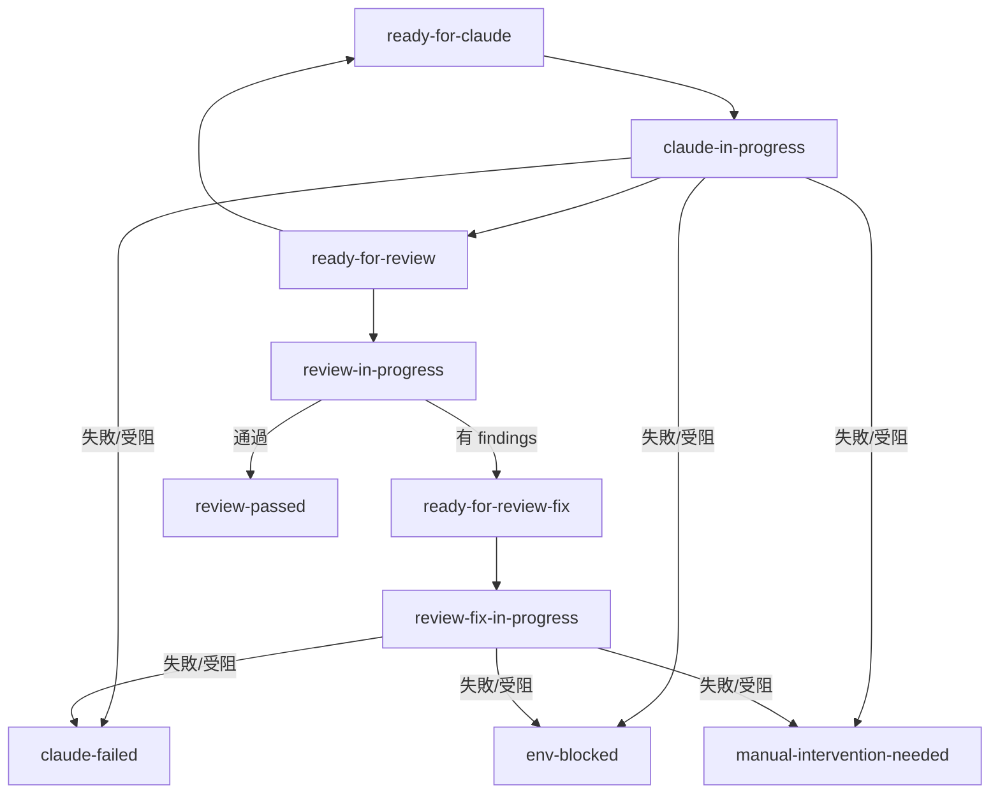

# GitLab Issue 驅動的 AI 自動開發（二）狀態機與卡單處理

> 本篇接續第一篇架構，說明用 GitLab label 當狀態機的設計：有哪些狀態、怎麼轉移、失敗與受阻怎麼區分，以及單卡住時要怎麼「放回去」讓 worker 重新接手。2026 年寫成，範例皆為虛構資料。

系列目錄：

- （一）架構
- （二）狀態機與卡單處理：本篇
- （三）設計教訓與 glab 踩坑

## 先講三個必須知道的限制

設計狀態機前，我先踩到 GitLab 的三個限制，它們決定了後面所有做法。

### 限制一：社群版沒有互斥的 scoped label

付費版有「同一組 scoped label 只能有一個」的功能，社群版沒有。我想要的是「一張單任何時刻只有一個狀態 label」，所以只能由程式自己維持：

- 換狀態時，在同一個請求裡「加新的、移舊的」。
- 完成後重新讀一次，確認結果符合預期。
- 每輪輪詢都檢查有沒有互斥的組合同時存在；如果有，貼一則狀態衝突留言、標成人工處理，並跳過這張單。

### 限制二：API 帶不存在的 label 會靜默新建

呼叫 API 時，如果 label 名稱打錯，GitLab 不會報錯，而是默默建一個新的。打錯字的結果是：看板上多了一個沒人認識的 label，原本的狀態沒變。

所以我做了兩件事：

- 啟動時比對專案的 label 清單，缺任何一個，worker 拒絕啟動並列出缺項。
- label 名稱不允許用環境變數改。如果兩端（實作與審查）各自改名，同一個狀態會出現兩種名稱，而啟動檢查還會通過，這比直接壞掉更難查。

### 限制三：留言列表看不到 label 何時被誰加減

要查某個 label 是什麼時候、被誰貼上的，要查 GitLab 的資源 label 事件（resource label events），不能只看留言。這在「查是誰把單放回去」時很有用。

## 十五個狀態 label

按顏色分組，顏色本身就是可讀性的一部分：

| 類別（顏色） | label | 意思 |
|---|---|---|
| 待認領（灰） | `ready-for-claude` | 規劃完成，等實作 worker |
| 待認領（灰） | `ready-for-review` | 實作完成，等審查 worker |
| 待認領（灰） | `ready-for-review-fix` | 審查有問題，等原實作者修 |
| 待認領（灰） | `task-revision-requested` | 規劃者要求修訂需求 |
| 進行中（藍） | `claude-in-progress` | 實作中 |
| 進行中（藍） | `review-in-progress` | 審查中 |
| 進行中（藍） | `review-fix-in-progress` | 修復中 |
| 進行中（藍） | `task-revision-in-progress` | 修訂中 |
| 等回答（橘） | `review-awaiting-answer` | 審查者在等實作者回答 |
| 等回答（橘） | `fix-awaiting-answer` | 修復者在等審查者回答 |
| 通過（綠） | `review-passed` | 審查通過，等規劃者合併 |
| 失敗或受阻（紅） | `claude-failed` | 實作 session 沒產出任何變更 |
| 失敗或受阻（紅） | `review-failed` | 修復輪或修訂輪沒產出 |
| 失敗或受阻（紅） | `manual-intervention-needed` | 需要人處理 |
| 失敗或受阻（紅） | `env-blocked` | 環境或規劃受阻 |

另外有兩個「附加標示」（淺灰，不算狀態），例如表示「這張單有開著的 MR」，以及「審查者是 AI」。專案專屬 label 也屬於附加標示，不隨狀態轉移。

命名上有一個小心思：每個階段都是三件組「待認領、進行中、結束」，看 label 名稱就知道現在輪到誰。

## 狀態轉移：挑重點講

完整的轉移表我編成 30 條左右，這裡只列最重要的幾條，用虛構的 issue #1 當例子：

```text
發單                          → ready-for-claude
認領                          → claude-in-progress
實作完成、測試綠、Draft MR 已開 → ready-for-review
審查有 findings（輪數 < 5）     → ready-for-review-fix
修復完成                       → ready-for-review
審查通過                       → review-passed
第 5 輪仍有 findings           → manual-intervention-needed
session 結束且沒有任何變更      → claude-failed
```

狀態圖：



圖上省略了問答與修訂的支線。這兩條支線是：

- **需求修訂**：MR 還是 open 的 Draft 時，規劃者可以貼 `task-revision-requested` 加一則修訂留言，讓實作者重做。
- **雙向問答**：審查者問實作者、修復者問審查者。

### 一個重要的邊界：來自其他單位的變更

如果變更要求是主管或其他單位提的，**我不改原本的單**，而是另開一張新 issue，用 `Depends-On` 串起來，原單也不貼修訂標記。原因是避免範圍被「口頭追加」悄悄撐大，每次變更都留下獨立的紀錄。

## 失敗與受阻：四個紅色 label 怎麼分

這是最容易混淆的部分。我用「發生了什麼」與「計不計輪數」來分：

| label | 意思 | 計輪數？ |
|---|---|---|
| `claude-failed` | 實作 session 結束了，但沒有任何變更 | 否 |
| `review-failed` | 修復或修訂輪沒有產出 | 否 |
| `manual-intervention-needed` | 測試紅、session 未確認完成、歷史違規、被砍後不能退回、第 5 輪仍有問題、久等不回被清掃、狀態衝突 | 視情況 |
| `env-blocked` | session 自己回報做不到（權限、環境、外部服務，或規格與現況衝突） | 否 |

### env-blocked：受阻停單，不是硬撐

這個狀態是後來才加的，也是我覺得最有價值的設計之一。

情境：實作 session 做到一半發現「需要的外部服務連不到」或「規格要求的東西與現有程式矛盾」。如果沒有這個狀態，只有兩種結果：

1. 硬撐，做出一個偏離規格的結果。
2. 失敗，浪費一輪審查次數。

加入 `env-blocked` 之後：session 自己回報原因類別（環境，或規劃），worker 立刻停單、貼一則受阻留言並 @ 規劃者，**不計入審查輪數**。如果當時已有部分變更，會另外推到一個 `wip/` 開頭的分支供人參考，但不會自動接續。

審查端還有一個相關的設計：**審查者的測試紅燈時，先在 base 分支對照跑一次。** 如果 base 也不綠，就判定是審查機器本身壞了，而不是這張單的錯，標成 `env-blocked` 而不是退回要實作者修。

實測教訓：我曾遇到「修復端本機綠、審查端一再紅」，最後發現審查機器的設定檔帶著舊的環境變數，且 worker 只在啟動時載入設定，改了沒重啟。這類問題如果沒有 base 對照，會變成實作者被無限退回。

### 用 label 區分「誰的錯」

整理成一句話：

- `claude-failed`、`review-failed`：程序本身沒產出，重試通常有意義。
- `manual-intervention-needed`：規則判定「不該再自動做」，需要人判斷。
- `env-blocked`：不是這張單的錯，是環境或規劃的問題，修好之後再放回去。

## 怎麼把卡住的單放回去

卡住的單常見的錯誤做法是「把 label 換回待認領」，結果又被同樣的原因擋一次。我的原則：

> **只換 label 常常不夠。要先修好原因，否則同一台機器會被同樣的原因再擋一次。**

審查端靠「交接留言」決定要不要審、審哪一段。所以放回去要看是哪一個階段卡住，並選下面三條路之一。

### 路 A：環境修好了，交回 worker 重做

適用：卡在實作、修復或修訂階段，原因（權限、環境變數、外部服務）已排除。

做法：

1. 移除 `env-blocked`。
2. 貼回該階段對應的待認領 label：

| 卡住的階段 | 貼回的 label |
|---|---|
| 初次實作 | `ready-for-claude` |
| 修復 | `ready-for-review-fix` |
| 需求修訂 | `task-revision-requested` |
| 審查 | `ready-for-review` |

worker 會把它當成新的一輪重新開工，不會接續 `wip/` 分支上的半成品。

### 路 B：程式都修好了，只剩環境驗證

適用：程式碼已經沒問題，只是審查端的環境需要重新驗證。

做法：

1. 先手動貼一則帶「新驗證批次標記」的 `[review-fix-complete]` 留言，並註明「僅驗證」。
2. 再貼 `ready-for-review`。

為什麼要先貼那則留言：審查端會判斷「這一版我審過了」就直接略過，而且不留任何留言，看起來像沒反應。新的驗證批次標記就是告訴它「雖然程式沒變，但請再驗一次」。

### 路 C：規劃者自己改程式、接手半成品

適用：不想再讓 worker 重做，由人（或規劃者的 session）親自完成。

做法：

1. 自己把提交推上分支。
2. 貼一則新的交接留言（`[review-ready]`，head 填目前分支頭）。
3. 再貼 `ready-for-review`，讓審查端審到。

### 放回去時的幾個陷阱

- 修復輪失敗（`review-failed`）的那一輪，程式修正**沒有**推上分支，不能當作已修好。
- 被砍轉人工的單，要看留言裡的原因欄位與下一步建議。原因有幾種：被砍且無進度、部分推送失敗、分支頭對不上、連續退回達上限、歷史違規。
- 「分支頭對不上」不能直接重貼 label，要先接手那條分支，或把遠端分支刪掉。
- 想在中途給實作者提示：改 issue 描述，或走修訂標記。一般留言不會被讀到（第一篇已說明）。

## 看單指南：看到什麼代表什麼

我另外整理了一張「看到什麼 label 加什麼留言，代表什麼、該誰動」的對照表，放在機器可讀的說明裡。濃縮版：

| 看到 | 代表 | 該誰動 |
|---|---|---|
| `ready-for-claude` 很久沒變 | 沒有 worker 在線，或缺必要環境變數被全部跳過 | 規劃者查 worker |
| `claude-in-progress`，心跳停了 | session 掛了或機器離線 | 租約過期後其他 worker 自動回收 |
| `env-blocked` | 環境或規劃有問題 | 規劃者，依上面三條路放回 |
| `manual-intervention-needed` | 規則判定不該再自動做 | 規劃者，看原因留言 |
| `review-passed` | 審查通過 | 規劃者，標 ready 並合併 |
| `claude-failed` | 實作沒有產出 | 規劃者，改善 issue 描述後重貼 |

## 審查的一個細節：通過，但有未驗項目

審查者有時會遇到「這個項目我的環境跑不了」。例如某個必須驗的情境需要特定的外部服務。處理方式：

- 如果 finding 被標記為「環境無法驗證」，而且沒有指到具體的程式碼行，**不會變成 findings 把單退回去**。
- 改記成「通過，但有 N 項必驗項目未驗（環境）」。
- **合併前必須由人驗完。**

這是在「不讓環境限制擋住流程」與「不假裝驗過了」之間的折衷。

## 實務檢查清單

放回一張單之前，我會逐項問：

- 卡住的原因是什麼？是程式、環境，還是規格？
- 原因真的修好了嗎？不是只換 label。
- 要走路 A、B、C 的哪一條？
- 如果走路 B，有先貼新的驗證批次留言嗎？
- 單上有沒有 `wip/` 分支？它只是參考，不會被自動接續。
- 重貼 label 後，下一輪輪詢（約一分鐘內）worker 有沒有接到？沒有的話查 worker 的紀錄。

## 小結

- label 當狀態機，三件組命名加顏色分組，讓人在看板上一眼看得出輪到誰。
- 社群版 GitLab 的限制（沒有互斥 label、打錯字靜默新建）要由程式自己防。
- 受阻（`env-blocked`）要與失敗分開，且不計入輪數，否則審查額度會被環境問題耗光。
- 放回卡住的單，先修原因再換 label。

下一篇是設計教訓：租約與心跳、對 AI session 的歷史守衛、被砍的接力、信任模型，以及 glab 的踩坑清單。
