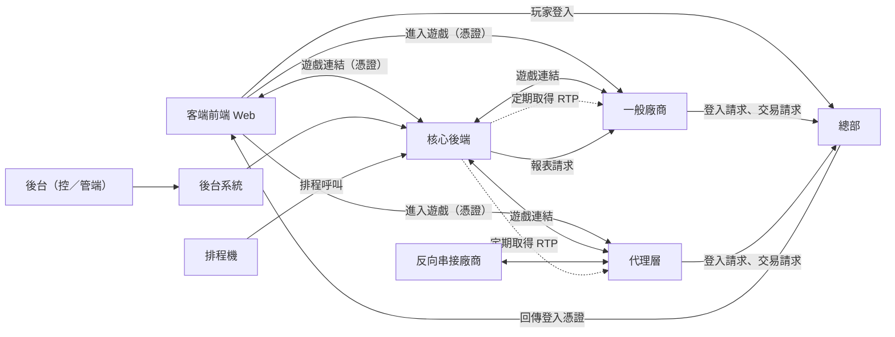
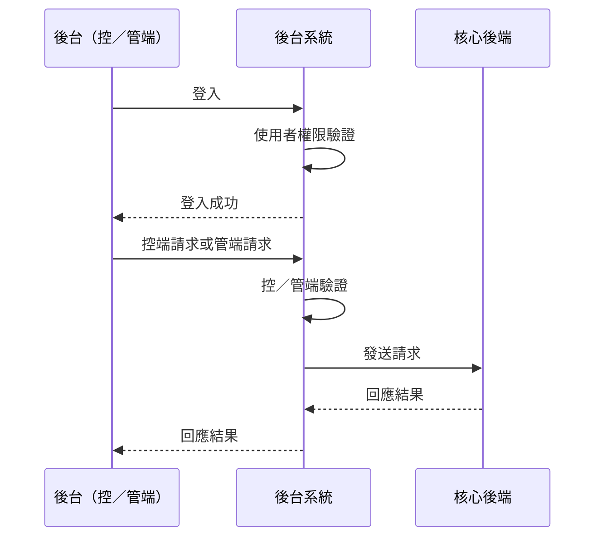
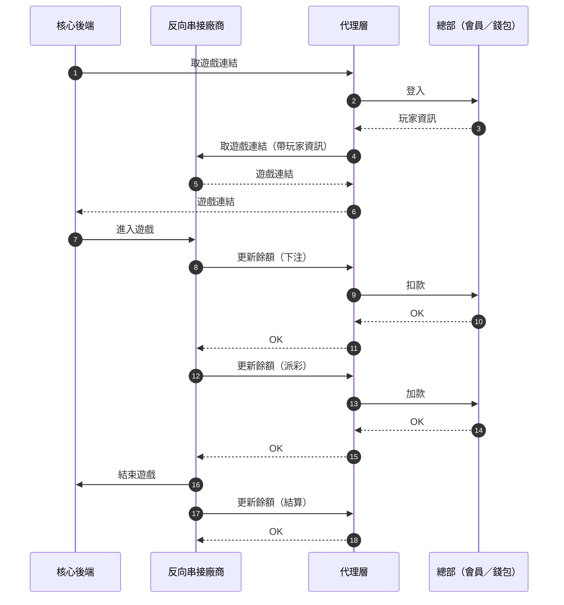

# Laravel 專案系統架構範例

> 以一個「遊戲平台後端」的通用架構為例，說明核心後端、後台、代理層、排程機與外部系統之間怎麼分工與互動，可作為請 AI 協作前交代系統全貌的範本。整理於 2026 年。

## 系統整體概觀

核心後端是一個**遊戲平台後端系統**，主要負責：

- **遊戲供應商整合**：取得遊戲連結、RTP、報表等
- **遊戲內容管理**：多站台的遊戲與供應商狀態控制
- **後台報表**：數據統計、日報表、月報表
- **中間層**：位於前端遊戲平台與各遊戲供應商之間

會員、錢包、登入驗證由另一個**總部系統**負責，核心後端本身不直接處理。

## 系統組成

### 外部系統

- **客端（多站台 Web 遊戲平台）**
    - 有多個營運站台，依站台取得對應的顯示資料
    - 取得顯示資料，如遊戲分類列表、遊戲列表與遊戲資訊（維護狀態、RTP）
    - 向總部登入後取得一組登入憑證，再帶著憑證向核心後端請求遊戲連結
    - 記錄使用者點擊、近期遊玩、搜尋記錄
- **特例站台（遊戲測試）**
    - **前哨站**：正式環境，用於遊戲上線前測試，僅供特定 IP，白名單帳號可取得未上架或維護中的遊戲
    - **QC 站**：測試環境，分國內與海外，僅開放廠商白名單測試遊戲
- **後台**
    - **控端**：管理多個站台的資料與狀態、使用者權限、遊戲供應商與遊戲資料、供應商與遊戲狀態的總開關、報表查詢
    - **管端（營運平台）**：管理單一站台、供應商與遊戲狀態的站台開關、報表查詢
- **總部**
    - 會員、錢包、登入驗證
    - 提供廠商遊戲下注、派彩、餘額查詢 API
    - 供應商報表查詢
- **遊戲供應商**
    - 主動串接核心後端
    - 與總部完成登入與交易
- **反向串接的供應商**
    - 由我方依對方協議串接
    - 透過代理層作為中間層

### 內部系統

- **後台系統**
    - 接收各站台後台的 API 請求，區分控端與管端，分別呼叫核心後端對應 API
    - 與核心後端透過內網溝通，操作站台、廠商、遊戲狀態，取得報表
    - 擁有僅供後台使用的內部會員系統
- **核心後端**
    - 與各遊戲廠商 API 溝通、取遊戲連結、製作報表
    - 控制站台、廠商、遊戲狀態
- **代理層（橋接器）**
    - 我方主動串接特定廠商協議，作為核心後端與該廠商之間的代理
    - 對核心後端來說等同於一般廠商
    - 與總部之間處理登入與交易
- **排程機**
    - 排程呼叫核心後端 API：製作報表、遊戲排序、更新廠商 RTP

## 架構圖



## 請求流程圖

### 客端：取得遊戲連結

有兩種流程，差別在「廠商何時向總部登入」。

1. **先登入才給連結**：廠商收到取連結請求時，先向總部登入，成功後才回傳遊戲連結。

    ```mermaid
    sequenceDiagram
      autonumber
      participant ClientFE as 客端
      participant HQ as 總部（會員／錢包）
      participant Core as 核心後端
      participant Vendor as 遊戲供應商

      ClientFE->>HQ: 登入請求
      HQ-->>ClientFE: 回傳登入憑證
      ClientFE->>Core: 攜帶憑證請求遊戲連結
      Core->>Vendor: 要求遊戲連結
      Vendor->>HQ: 登入
      HQ-->>Vendor: 玩家資訊
      Vendor-->>Core: 遊戲連結
      Core-->>ClientFE: 遊戲連結
      ClientFE->>Vendor: 開啟遊戲
      Note over Vendor,HQ: 下注、派彩、餘額查詢由供應商與總部直接溝通
      Vendor->>ClientFE: 結束遊戲
    ```

2. **先給連結才登入**：廠商先回傳遊戲連結，玩家開啟遊戲後才向總部登入。

    ```mermaid
    sequenceDiagram
      autonumber
      participant ClientFE as 客端
      participant HQ as 總部（會員／錢包）
      participant Core as 核心後端
      participant Vendor as 遊戲供應商

      ClientFE->>HQ: 登入請求
      HQ-->>ClientFE: 回傳登入憑證
      ClientFE->>Core: 攜帶憑證請求遊戲連結
      Core->>Vendor: 要求遊戲連結
      Vendor-->>Core: 遊戲連結
      Core-->>ClientFE: 遊戲連結
      ClientFE->>Vendor: 開啟遊戲
      Vendor->>HQ: 登入
      HQ-->>Vendor: 玩家資訊
      Note over Vendor,HQ: 下注、派彩、餘額查詢由供應商與總部直接溝通
      Vendor->>ClientFE: 結束遊戲
    ```

### 後台



### 代理層



## 系統架構關鍵概念

### 資料流程

1. **取得遊戲連結**：客端 → 核心後端 → 廠商或代理層 → 總部
2. **遊戲狀態管理**：後台系統 → 核心後端 → 廠商
3. **報表生成**：排程機 → 核心後端 → 廠商
4. **RTP 更新**：核心後端定期向廠商取得

### 技術架構特點

- **多資料庫架構**：核心資料、報表、進入記錄與各廠商資料分庫
- **佇列系統**：以 Laravel Horizon 管理背景任務
- **快取系統**：Redis 多層級快取
- **API 設計**：RESTful API 端點
- **容器化部署**：Podman + Alpine Linux
- **開發環境**：Laravel 內建開發伺服器

## 把這份範本用在自己的專案

- 先畫出「誰呼叫誰」的方向，再標示哪些是內部系統、哪些是外部系統
- 寫清楚哪個系統擁有會員與錢包這類核心資料，避免 AI 在錯誤的系統裡補功能
- 流程相近但時序不同的情境（如上面兩種取連結流程）分開畫，不要合併成一張圖
